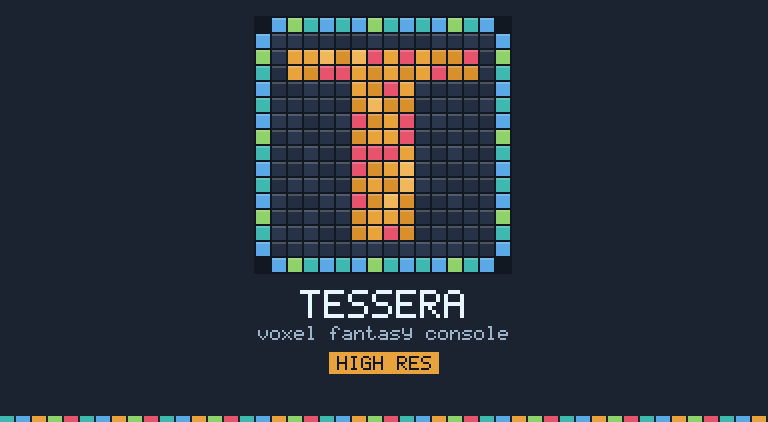

<p align="center">
  
</p>

# Tessera Kit

Developer tools, CLI, MagicaVoxel pipeline, project scaffolder, and Model Context Protocol (MCP) server for the **Tessera High-Res** voxel fantasy console (`256×256×128` voxel volume, `768×432` WebGL2 raymarcher, Lua 5.4).

All three packages are published on the **public npm registry**:

- **[`@stephenwil/tessera`](https://www.npmjs.com/package/@stephenwil/tessera)**: Unified developer CLI (`init`, `dev`, `pack`, `unpack`, `vox`, `export`, `check`, `mcp`), live-reload dev server, `.vox` importer, `.tess.png` picture-cart codec, single-file HTML exporter, and built-in MCP server.
- **[`@stephenwil/create-tessera`](https://www.npmjs.com/package/@stephenwil/create-tessera)**: Zero-setup project scaffolder (`npm create @stephenwil/tessera <my-game>`).
- **[`@stephenwil/tessera-mcp`](https://www.npmjs.com/package/@stephenwil/tessera-mcp)**: Dedicated standalone MCP server executable for AI coding agents.

---

## Quick Start (npm)

Create, run, pack, and export a voxel game without cloning any repositories:

```sh
# 1. Scaffold a new cart project
npm create @stephenwil/tessera my-game
cd my-game
npm install

# 2. Start the live hot-reload development server (http://localhost:3000)
npm run dev

# 3. Validate syntax and manifest structure
npm run check

# 4. Pack into a plain-text .tess cart and steganographic .tess.png picture cart
npm run pack

# 5. Export a self-contained offline single-file HTML game (dist/my-game.html)
npm run build
```

You can also run any CLI command directly via `npx` without installing globally:

```sh
npx @stephenwil/tessera dev
npx @stephenwil/tessera check
npx @stephenwil/tessera pack
npx @stephenwil/tessera export
npx @stephenwil/tessera vox models/hero.vox --name hero --gen-pal
npx @stephenwil/tessera mcp
```

---

## 1. System Architecture & npm Package Ecosystem


- **`tessera-high-res` (Engine)**: Core 256×256×128 voxel volume, WebGL2 768×432 raymarcher, `wasmoon` Lua 5.4 runtime, and regression suite. Compiles the self-contained web runner bundled into `@stephenwil/tessera`.
- **`tessera-kit` (Public npm Tooling)**: Publishes `@stephenwil/tessera`, `@stephenwil/create-tessera`, and `@stephenwil/tessera-mcp` to the public npm registry.
- **Cart Projects (`my-game/`)**: Standard `tessera.json` projects using `@stephenwil/tessera` as a `devDependency` to develop, check, pack, and export standalone carts.

---

## 2. Project Manifest & Assembly Pipeline


Each project defines its cart metadata, script order, model pivots, and asset sources in `tessera.json`:

```json
{
  "id": "mygame",
  "title": "My Game",
  "author": "Author Name",
  "version": "1.0.0",
  "lua": ["src/player.lua", "src/world.lua", "src/main.lua"],
  "models": {
    "hero": { "file": "models/hero.vox", "pivot": [10, 6, 0] },
    "tree": { "file": "models/tree.vox", "pivot": "center" }
  },
  "palette": "assets/palette.txt",
  "sfx": "assets/sfx.txt"
}
```

Running `npm run pack` / `npm run build` (or zero-argument `tessera pack` / `tessera export` inside the project root) assembles `tessera.json` and emits:

- **`dist/<id>.tess`**: Canonical plain-text cart (`tessera cart v1`).
- **`dist/<id>.tess.png`**: Steganographic 256×256 picture cart with hidden deflate-compressed bytes.
- **`dist/<id>.html`**: Offline standalone single-file HTML game playable anywhere without a server.

---

## 3. CLI Workflow & Live Hot Reload


| Command | Description |
|---|---|
| `tessera init [dir]` | Scaffold a new project with `tessera.json`, `src/main.lua`, `assets/palette.txt`, and VS Code LuaLS typings. |
| `tessera dev [path]` | Start local dev server (`http://localhost:3000`, `0.0.0.0`) with file watching and SSE live reload. Supports `--port` and `--host`. |
| `tessera check [path]` | Assemble and validate cart sections, manifest metadata, and Lua block balance. |
| `tessera pack [path]` | Assemble and encode a cart into a steganographic `.tess.png` picture cart (supports custom 256×256 `--label` and `-o`). |
| `tessera unpack <png>` | Decode a `.tess.png` picture cart back into readable `.tess` text. |
| `tessera vox <files...>` | Convert one or more MagicaVoxel `.vox` models into Tessera `__models__` / `__pal__` text with automatic palette deduplication. |
| `tessera export [path]` | Export an offline single-file `.html` runner embedding your cart (no server required). |
| `tessera mcp` | Start the Model Context Protocol (MCP) stdio server for AI coding agents. |

---

## 4. Voxel Asset Pipeline (`.vox` & Palette Merging)


- **MagicaVoxel / Goxel Support**: Parses binary `.vox` files, extracts multi-frame models, and converts them to Tessera's voxel space.
- **Palette Deduplication**: Collapses identical `#RRGGBB` colors across all models.
- **Strict Budgeting**: Verifies that total unique colors stay within the 255-index limit (index `0` is reserved for transparent air).
- **Custom Palettes**: Define overrides in `assets/palette.txt` (`<index> <rrggbb>` or `<index>: #<rrggbb>`).

---

## 5. Developer Scaffolding & Web Distribution


- **Quickstart**:
  ```sh
  npm create @stephenwil/tessera my-game
  cd my-game
  npm install
  npm run dev
  ```
- **Web Distribution**: Share standalone single-file `.html` games on itch.io or USB, post `.tess.png` picture carts on the web for drag-and-drop play, or deep-link carts into any hosted Tessera player (`?cart=https://.../game.tess`).

---

## 6. Lua API Quick Reference


All 3D coordinates are in voxel room space (`256×256×128`, `x` east, `y` north, `z` up). Palette indices are `1..255` (`0` is transparent air). HUD coordinates are in `768×432` screen canvas space.

### Core API Summary

| Category | Functions | Notes |
|---|---|---|
| **Map Layer** (persists) | `mset`, `mget`, `mbox`, `mmodel`, `mheight`, `mclear` | Persistent world volume; only modified 16³ bricks upload to GPU. |
| **Draw Layer** (per-frame) | `cls`, `vset`, `vget`, `box`, `sphere`, `line3d`, `model`, `particle` | Rebuilt every frame; `cls()` clears only dirty draw bricks. |
| **Models** | `newmodel`, `mpset`, `msize`, `mvox` | Runtime procedural voxel models (or imported via `.vox` in `models/`). |
| **Spatial & Collision** | `raycast3d`, `check_box`, `sweep_box`, `sweep_down`, `vheight` | Host-side 3D DDA raycast and AABB sweeps (`layer`: `0`=both, `1`=map, `2`=draw). |
| **Camera, Light & Quality** | `camera`, `sun`, `sky`, `fog`, `pal`, `palt`, `pswap`, `quality` | Orthographic camera `camera(x,y,z,[zoom],[yaw])`, sun shadows, sky gradient, and `"standard"`/`"hq"` presets. |
| **HUD & 2D Overlay** | `print`, `textw`, `rect`, `rectfill`, `circfill`, `spr2d`, `project` | Cleared every frame. Crisp 5×7 font (6px advance) drawn over the raymarched scene. |
| **Input** | `btn(b, [p])`, `btnp(b, [p])`, `axis(n, [p])` | Up to 4 players (`0..5` directional/A/B, `6`=M). Merges keyboard, gamepad, and touch. |
| **Audio & Tracker** | `tone`, `sfx`, `mute`, `music`, `music_stop`, `music_pos`, `music_vol` | 4-channel Web Audio synth (`square`, `triangle`, `saw`, `noise`) plus `__music__` tracker playback. |
| **Math & System** | `t()`, `flr`, `mid`, `rnd`, `noise3`, `stat`, `dset`, `dget`, `printh` | Fixed 30 Hz game time `t()`, 3D noise, persistent cart storage, and profiling. |

### Background Music & Audio Synthesis

Tessera synthesizes audio in real-time across **4 concurrent channels** (`ch = 0..3`) via Web Audio using `tone(wave, f0, [f1], dur, [vol], [ch])`.

To sequence background music in a cart, schedule notes along the fixed 30 Hz timer `t()`:

```lua
-- Simple 4-note background music sequencer
local melody = { 261.63, 329.63, 392.00, 523.25 } -- C4, E4, G4, C5
local last_step = -1

function _update()
  -- Step notes at 4 Hz (quarter seconds)
  local step = flr(t() * 4) % #melody + 1
  if step ~= last_step then
    last_step = step
    -- Play note on channel 0 (triangle wave, 0.2s duration, 0.15 volume)
    tone("triangle", melody[step], melody[step], 0.2, 0.15, 0)
  end
end
```

---

## 7. Cart Distribution, Web Delivery & Tailnet Testing

Carts exist as either human-readable `.tess` text files or steganographic `.tess.png` picture carts (which store deflate-compressed cart text in the low 2 bits of the RGBA channels, up to 64 KiB).

```
   [ Local Dev Server (tessera dev) ] ──────► http://localhost:3000/
                                    │
                                    ├───► Drag-and-drop .tess / .tess.png
                                    ├───► Deep link (?cart=<slug or url>)
                                    └───► File picker ("Load cart...")
```

### Downloading Demo Carts (Tessera Showcase)

The bundled CLI runner keeps only the minimal `hello` starter cart so your dev server and exported `.html` builds stay lean (~647 KiB). To play, inspect, or download full demo carts (`.tess` source and `.tess.png` picture carts), visit the **[Tessera Cartridge Showcase](https://stephenwil.github.io/tessera-showcase/)**:

```sh
# Open any downloaded demo cart locally with live reload
npx @stephenwil/tessera dev path/to/downloaded.tess
```

### Local Network & Tailscale Testing
`tessera dev` binds to `0.0.0.0:3000` by default, so you can playtest on phones, tablets, or laptops across your LAN or Tailnet:

- **Dev Server URL**: `http://<lan-or-tailscale-ip>:3000/`
- **Live In-Console Code Editor**: Press **F4** to edit Lua 5.4 code live in the browser; press **F5** to open the voxel model editor; press **F3** to toggle performance stats.

---

## 8. Building Games with AI Agents (CLI & MCP)

AI coding agents can create, validate, pack, and export Tessera games in two ways:

1. **Without MCP (shell / terminal agents)**: Any agent with shell access can run `npm create @stephenwil/tessera my-game`, write Lua into `src/main.lua`, validate with `npx @stephenwil/tessera check`, pack with `npx @stephenwil/tessera pack`, and export playable HTML with `npx @stephenwil/tessera export`.
2. **With MCP (recommended for Claude Desktop, Cursor, T3 Code, and tool-only agents)**: Connect the built-in **Model Context Protocol (MCP)** server so the agent gets structured tools and live, accurate API documentation without shelling out or guessing function signatures.

### Starting the MCP Server

```sh
# Via the main CLI package
npx -y @stephenwil/tessera mcp

# Or via the dedicated standalone MCP package
npx -y @stephenwil/tessera-mcp
```

### Client Configuration (`claude_desktop_config.json`, Cursor, T3 Code)

```json
{
  "mcpServers": {
    "tessera": {
      "command": "npx",
      "args": ["-y", "@stephenwil/tessera", "mcp"]
    }
  }
}
```

Or using the dedicated package:

```json
{
  "mcpServers": {
    "tessera": {
      "command": "npx",
      "args": ["-y", "@stephenwil/tessera-mcp"]
    }
  }
}
```

### Available MCP Tools

| Tool | Parameters | Description |
|---|---|---|
| `tessera_init_cart` | `directory`, `name`, `title`, `author` | Scaffolds a new cart project with manifest, starter loop, palette, and VS Code typings. |
| `tessera_check_cart` | `path` | Fast validation of cart structure, balanced Lua blocks, and manifest schema. |
| `tessera_assemble_cart` | `projectDir` | Assembles multi-file Lua scripts and models into a `.tess` cart. |
| `tessera_pack_cart` | `cartPath`, `outputPath`, `labelPath` | Packs `.tess` into a shareable steganographic `.tess.png` picture cart. |
| `tessera_export_html` | `cartPath`, `outputPath` | Exports a self-contained offline single-file `.html` game runner. |
| `tessera_inspect_vox` | `voxPath` | Inspects MagicaVoxel `.vox` dimensions, models, frame count, and color palette. |
| `tessera_check_palette_budget` | `projectDir`, `maxColors` | Scans all models, deduplicates colors, and verifies compliance with the ≤ 255 palette limit. |
| `tessera_api_docs` | `topic` (`all`, `map`, `draw`, `collision`, `camera`, `hud`, `input`, `audio`, `math`) | Retrieves live, accurate Lua API signatures and notes directly into agent context. |

---

## License

MIT © Stephen Wilson — see [LICENSE](LICENSE).
